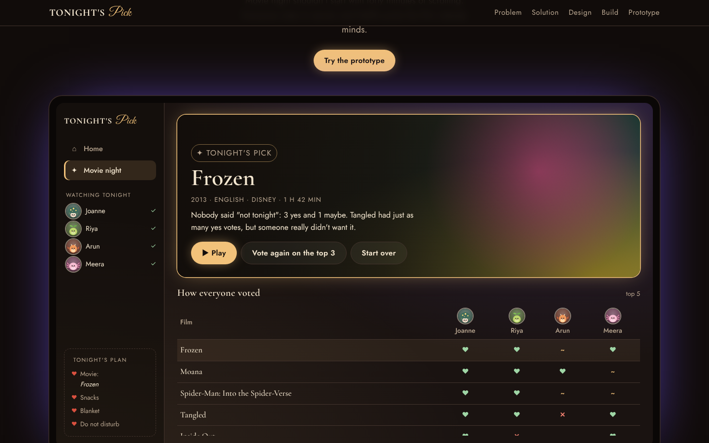

# 🍿 Tonight's Pick — a group movie-night picker for Netflix

**Improve It!** submission by **Joanne** for the IEEE WIE Technical Domain.

🔗 **Live case study + working prototype:** https://joannebjomy.github.io/tonights-pick/



---

## 1. Product & Problem

**Product:** Netflix.

**Problem:** Netflix is great at recommending films to *one* person, but movie night is rarely one person. When friends watch together:
- **Endless scrolling:** recommendations are built for one profile, so the group scrolls and negotiates film by film.
- **The loudest voice wins:** people go along with the first confident suggestion, and the quiet friend sits through something they dislike.
- **No help choosing together:** Netflix recommends for one profile at a time, and watch-party tools only sync playback. Nothing helps a group *decide*.

## 2. My Solution

**Tonight's Pick** is a group mode that turns "what should we watch?" into a two-minute vote.

1. **Start a movie night:** the host taps *Movie night* on the TV; friends scan a QR code to join on their own phones.
2. **Set the ground rules:** time available, mood, and languages everyone understands. Netflix builds a shortlist of 8, skipping anything someone has already seen.
3. **Vote in secret:** everyone swipes *Yes*, *Maybe* or *Not tonight*. Nobody sees other votes until the end.
4. **Get a fair pick:** a **"least misery"** rule (from group-recommendation research) picks the film whose least happy person is happiest, and explains why.

**The fairness rule:**
1. Prefer films where nobody said *Not tonight*.
2. Among those, prefer the most *Yes* votes.
3. Still tied? Pick the shorter film.

So a film with 3 yes and 1 "not tonight" loses to one with 2 yes and 2 maybe.

## 3. Visual Representation

The live page includes a **user-flow chart**, **wireframes** of the TV and three phone screens, an **architecture diagram**, and the **high-fidelity working prototype**.

## 4. Implementation

1. **Sessions:** the TV app creates a movie-night session with a code and QR. Phones join through a web page, so friends don't need the app.
2. **Shortlist:** a service combines everyone's profiles, removes anything already watched, applies the filters and ranks the rest.
3. **Live voting:** votes go over WebSockets and are kept in Redis, hidden until everyone's done.
4. **Fair pick:** the least-misery rule picks the film and writes a one-line reason; the TV shows it and starts playing.
5. **Learn:** a thumbs up or down after the film improves the group's next shortlist.

**Tools:** React (phones) · Netflix TV app · Node.js + Socket.IO + Redis (real time) · Netflix recommendation data (shortlist).

**How I'd measure it:** time from opening Netflix to pressing play; share of movie nights that end with a film playing; thumbs up from everyone afterwards.

## 5. Working Prototype

A complete working version on one phone, with 30 sample films: Marvel, Disney and Pixar, Malayalam favourites, and films in Hindi, Tamil, Telugu, Kannada and Marathi.

**Try it:**
1. Choose who's watching, the time and the mood, then **Build our shortlist**.
2. Vote with the buttons, the arrow keys, or by swiping the card left and right.
3. Tap a creature on a ticket to choose a profile picture.
4. See tonight's pick, the reason, and everyone's votes. Try **Vote again on the top 3**.

- **Demo friends (box ticked):** only you vote; friends vote based on their tastes (e.g. Riya loves comedies and avoids sad films).
- **Pass the phone (box unticked):** everyone votes in turn, with a hand-off screen so votes stay secret.
- **Not in the prototype yet:** separate phones joining live, and real Netflix data. Those are the backend steps above.

### Tech stack (prototype)
- **HTML, CSS, vanilla JavaScript** — no frameworks or libraries
- Hosted on **GitHub Pages**

### Files
```
index.html    case study + prototype page
style.css     styling and responsive layout
app.js        setup, profile pictures, voting, swiping, the fairness rule and results
avatars.js    the 9 hand-drawn SVG movie-buddy creatures
movies.js     sample films, moods and the demo friends' tastes
preview.png   screenshot for this README
```

### Run it locally
Download the repo and open `index.html` in a browser. No installation needed.

---
*A student concept. Not made by or affiliated with Netflix. Film titles are used only as sample data; descriptions are my own.*
